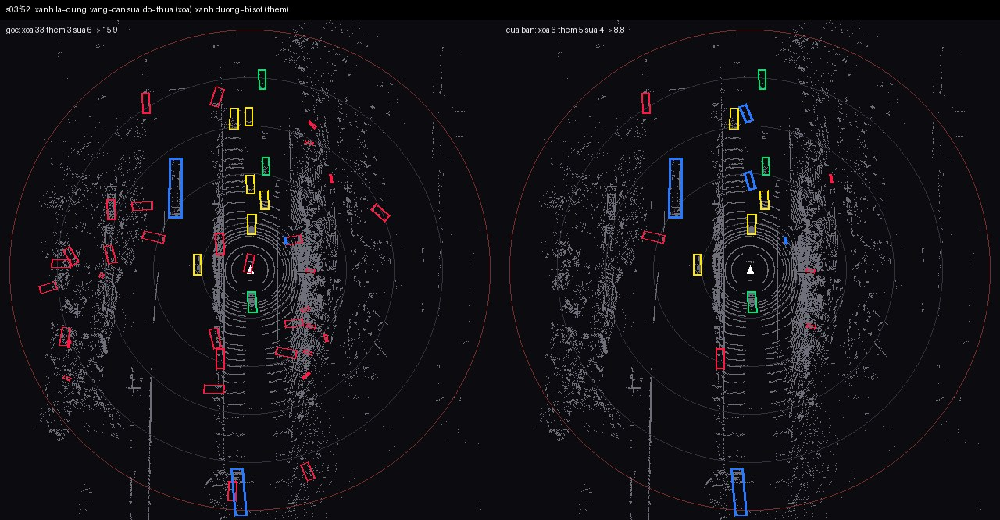

# Báo cáo Day 14 — Nguyễn Tuấn Điệp — 2A202603057

- Mã học viên dùng với `--student`: `2A202603057`
- `seed_tag` trong `frames_A.txt`: `393590736f`

## 1. Dự đoán trước sweep (bước 5b)

Ghi **trước** khi chạy `scripts/pp_sweep.py`, rồi commit và push ngay (lịch sử commit là bằng chứng thời điểm viết). Không sửa phần này sau khi có kết quả.

- Tham số tôi nghĩ giảm công sửa nhiều nhất: Tăng `score_thr` (khoảng `0.4`–`0.5`) kết hợp tăng nhẹ `min_points` (khoảng `5`–`10`).
- Vì sao (nhìn ảnh BEV tập A: box thừa nhiều hay box sót nhiều?): Quan sát 3 ảnh BEV tập A (`s02f31`, `s03f52`, `s05f31`) và quá trình sửa tay trên CVAT cho thấy **box thừa nhiều áp đảo** so với box sót (cấu hình gốc sinh tới 102 box nhưng chỉ có 35 vật thể thật cần giữ). Phần lớn box thừa là các hộp `Cyclist`, `Pedestrian` và `Car` ảo ở lề đường/bụi cây/vùng xa có điểm tin cậy thấp (`score < 0.4`) và rất ít điểm LiDAR. Dù mỗi hộp xóa chỉ tốn `0.3` điểm (thấp hơn `1.0` điểm khi thêm hộp sót), tổng số hộp thừa quá lớn nên lọc bớt bằng `score_thr` và `min_points` được kỳ vọng sẽ giảm mạnh chi phí xóa mà không làm mất nhiều xe thật (chủ yếu là `Car`/`Bus` rõ điểm).

## 2. Tập A: sửa tay và tune

| Cấu hình | Xóa | Thêm | Sửa | Chi phí |
|---|---:|---:|---:|---:|
| Gốc | 70 | 3 | 16 | 32.0 |
| `best_config.json` | 11 | 6 | 14 | 16.3 |

- Tham số đã đổi trong `best_config.json`: tăng `score_thr` từ `0.1` lên `0.5`, còn `min_points` giữ nguyên `0` (vì khi `score_thr = 0.5` thì `min_points` để `0`, `5` hay `10` đều ra đúng chi phí `16.3`).
- Kết quả leave-one-out (dán các dòng `scripts/pp_sweep.py` in ra):
  ```text
  Leave-one-out (chọn trên các frame còn lại, chấm trên frame bỏ ra):
    s02f31: cấu hình chọn {'score_thr': '0.5', 'min_points': '0'} → 3.8 (tốt nhất có thể 3.8)
    s03f52: cấu hình chọn {'score_thr': '0.5', 'min_points': '0'} → 8.8 (tốt nhất có thể 8.8)
    s05f31: cấu hình chọn {'score_thr': '0.5', 'min_points': '0'} → 3.7 (tốt nhất có thể 3.7)
  ```
- Cấu hình có ổn định trên từng frame không? Vì sao tôi vẫn chọn (hoặc không chọn) nó: Khá ổn định trên cả 3 frame tập A. Khi bỏ lần lượt từng frame ra để kiểm tra chéo, cấu hình chọn từ 2 frame còn lại vẫn ra đúng `{'score_thr': '0.5', 'min_points': '0'}` và khớp luôn mức chi phí thấp nhất trên frame còn lại (`3.8`, `8.8`, `3.7`). Vì không thấy dấu hiệu bị lệch theo riêng một frame nào nên tôi dùng `best_config.json` này để chạy tập B.

## 3. Trước/sau (bước 8)



- `scripts/pp_compare.py` báo giảm 49% công sửa trên tập A (tổng chi phí giảm từ `32.0` xuống `16.3`; từng frame: `s02f31` từ `9.4` xuống `3.8`, `s03f52` từ `15.9` xuống `8.8`, `s05f31` từ `6.7` xuống `3.7`).
- Dự đoán ở mục 1 đúng hay sai? Giải thích bằng số box xóa/thêm/sửa: Dự đoán đúng ở phần chính (`score_thr = 0.5`), nhưng đoán dư phần `min_points`. Khi nâng `score_thr` từ `0.1` lên `0.5`, số box thừa phải xóa giảm mạnh từ `70` xuống còn `11` (bớt được `59` box, giảm `17.7` điểm), số box cần sửa cũng giảm từ `16` xuống `14` (giảm `1.0` điểm). Đổi lại chỉ bị sót thêm `3` box (từ `3` lên `6`, tốn thêm `3.0` điểm), nên tổng thể vẫn giảm được `15.7` điểm. Riêng `min_points` (tôi đoán nên tăng lên `5–10`) thực tế không tác dụng thêm ở mức `score_thr = 0.5`, vì đa số các box nhiễu ít điểm đã có điểm tin cậy dưới `0.5` và bị lọc mất trước rồi.

## 4. Tập B

Số đo từ `scripts/pp_prelabel.py --frames d14_2A202603057/frames_B.txt --config d14_2A202603057/best_config.json --gt d14_2A202603057/ref_B.json` (12 frame, tổng 123 box tham chiếu, model dự đoán 147 box và khớp 108 box):

| Xóa | Thêm | Sửa | Chi phí |
|---:|---:|---:|---:|
| 39 | 15 | 54 | 53.7 |

- Loại box tốn công sửa nhất ở tập B:
  - Tính theo tổng chi phí thì `Car` tốn công nhất (`35.7/53.7` điểm), chủ yếu nằm ở `51` box cần sửa lại kích thước hoặc vị trí (trong đó `48/54` ca sửa toàn tập B bị lệch kích thước quá `0.2 m`, thường gặp ở các xe bị che khuất một phần hoặc kích thước xe thực tế khác form KITTI) và `24` box thừa phải xóa.
  - Xét riêng theo từng lỗi khó chịu lúc sửa trên CVAT: `Cyclist` sinh khá nhiều box ảo ở cột và cây ven đường (phải xóa `15` box, thêm `3`, sửa `2`, tổng `8.5` điểm); còn `Truck` (`3/3` sót), `Bus` (`2/2` sót) và `Pedestrian` (`4/5` sót) gần như phải tự vẽ mới hoàn toàn vì model KITTI không có lớp `Truck`/`Bus` và nhận người đi bộ khá kém.

## 5. Giới hạn

- Chỉ tune trên 3 frame tập A nên cỡ mẫu còn rất nhỏ, chưa chắc đã là mức tối ưu nhất cho toàn bộ dữ liệu VF. Dù trên tập B chi phí trung bình (`4.48` điểm/frame) thấp hơn tập A (`5.43` điểm/frame), việc dùng chung một ngưỡng `score_thr = 0.5` cho mọi lớp khiến `Cyclist` vẫn còn nhiều box ảo (`15` box xóa) trong khi `Pedestrian` lại bị sót nhiều (`4/5`). Nếu tách ngưỡng riêng từng lớp (`thr_car`, `thr_cyc`, `thr_ped`) và tune trên nhiều frame hơn sẽ thực tế hơn.
- Model PointPillars được huấn luyện sẵn trên KITTI (chỉ có 3 lớp `Car`, `Pedestrian`, `Cyclist` và quét phía trước) nên khi đưa sang dữ liệu VF bị hụt hoàn toàn `Truck` và `Bus` (trên tập B cả 3 xe tải và 2 xe buýt đều phải vẽ tay lại), đồng thời kích thước hộp `Car` model dự đoán hay bị rộng hoặc hụt quá `0.2 m` so với thực tế.
- Chi phí `0.3·xóa + 1.0·thêm + 0.5·sửa` chỉ là công thức ước lượng để so sánh nhanh giữa các cấu hình, chưa phản ánh đúng thời gian sửa thật trên CVAT. Thực tế vẽ mới một chiếc `Bus`/`Truck` hay căn lại góc xoay và đáy hộp sát mặt đường cho xe bị bụi cây che mất nhiều công hơn hẳn so với việc bóp nhẹ chiều dài một chiếc `Car` rõ điểm. Ngoài ra công thức chấm theo BEV nên cũng chưa đo được lỗi hộp bị chìm, lơ lửng theo trục `z` hay bị ngược đầu `180°`.
